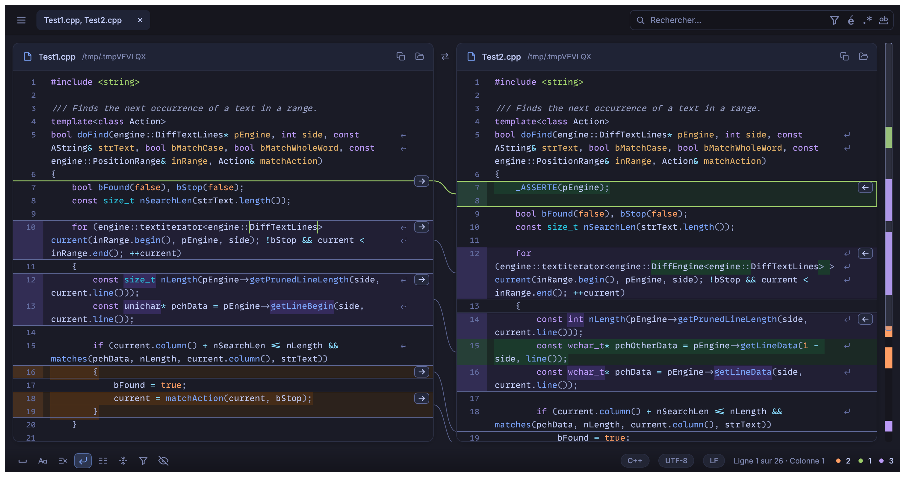
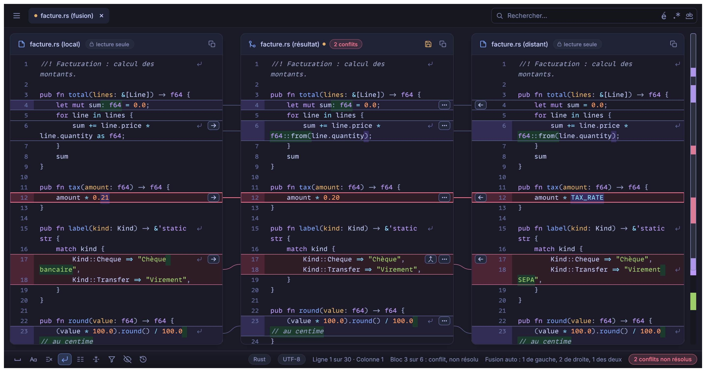

# BioMerge

Comparaison de fichiers et de dossiers, et fusion à 3 voies, en Rust pur. L'objectif : la lisibilité d'Araxis Merge, avec la vitesse de Rust et une interface sobre.



## Fonctionnalités

**Comparaison de texte**
- Comparaison en trois niveaux : lignes (Histogram et heuristique d'indentation de Git), appariement des lignes semblables à l'intérieur d'un bloc, puis mots à l'intérieur des lignes appariées.
- Un bloc reste un seul cadre, même s'il mélange lignes modifiées, ajoutées et supprimées. Le texte ajouté est en vert, le texte supprimé en orange, le texte remplacé en violet.
- Deux affichages :
  - par défaut, chaque volet garde ses propres lignes et défile à sa propre vitesse dans un bloc, sans lignes vides de remplissage ;
  - « Aligner les lignes » garde les lignes en vis-à-vis.
- Édition directe dans les deux volets, et la comparaison suit chaque frappe. Transfert d'un bloc d'un côté à l'autre, annulation et rétablissement.
- Coloration syntaxique, encodages préservés à l'octet près (UTF-8, UTF-8 BOM, UTF-16, Windows-1252), fins de ligne conservées. L'enregistrement est atomique et refuse d'écraser un fichier modifié sur le disque entre-temps.
- Options de comparaison :
  - espaces : exacts, en fin de ligne, ou tous ignorés ;
  - casse ;
  - règles d'ignorance par expression régulière, sur un fragment ou une ligne entière, avec des préréglages (dates, heures, UUID, empreintes, numéros de version, nombres).
- Recherche dans les deux volets, filtre de blocs, aller à la ligne, mode « différences seules » avec lignes de contexte.

**JSON**
- Comparaison structurelle : un réordonnancement des clés ne crée aucune différence. L'ordre des clés peut suivre le fichier de référence, rester tel qu'écrit, ou être alphabétique.
- Tableaux appariés par identifiant (`id`, `uuid`, `name`…), ou traités comme des ensembles sans ordre.
- `1.0` et `1`, `é` et `é` sont égaux, sans aucune perte de précision sur les grands nombres. Les clés en double sont conservées.
- Chemin JSON de la ligne courante, liste des changements par chemin, réparation des virgules après un transfert de bloc.

**Documents Word et OpenDocument**
- Les fichiers `.docx` et `.odt` sont comparés par leur texte, en lecture seule : un paragraphe par ligne, avec titres, listes, tableaux et notes en Markdown.
- Le texte final des modifications suivies est affiché par défaut ; le texte d'origine est disponible en option.
- Ce qui n'est pas comparé (mise en forme, images, commentaires…) est signalé.

**Dossiers**
- Comparaison parallèle de deux arborescences, avec respect de `.gitignore` en option et filtre par nom (`*.rs -target/ -*.lock`).
- Les documents ou fichiers JSON dont seuls les octets diffèrent sont signalés « même texte » ou « même valeur ».
- Copier ou supprimer (corbeille par défaut) après un récapitulatif à confirmer.
- Deux synchronisations : rendre un côté identique à l'autre (miroir), ou mettre à jour dans les deux sens. Dans le second cas, deux fichiers différents de même date sont signalés en conflit et ne sont pas touchés.

**Fusion à 3 voies**



- Disposition : version locale à gauche, résultat éditable au centre, version distante à droite. La base s'affiche à la demande.
- Les changements d'un seul côté, ou identiques des deux côtés, sont fusionnés automatiquement, et les conflits sont réduits à leurs lignes réellement différentes.
- Pour chaque conflit : prendre la gauche, la droite, les deux dans un ordre ou l'autre, ou la base. On peut aussi combiner deux changements voisins, ou éditer à la main.
- Lecture et écriture des marqueurs de conflit de Git (styles `merge` et `zdiff3`). Un fichier déjà en conflit peut être ouvert directement.

**Apparence**
- Six thèmes :
  - **Verre**, par défaut : fenêtre translucide que le compositeur floute, comme Hyprland ;
  - **Ardoise et papier** : interface sombre, code clair ;
  - **Porcelaine** : clair, avec un dock flottant ;
  - **Graphite** : monochrome ;
  - **Tokyo Night** ;
  - **Clair**.
- Le code peut rester clair ou sombre quel que soit le thème.
- Les blocs sont reliés entre les volets par des lignes fines ou par des rubans qui s'élargissent et se rétrécissent, au choix.
- La taille du code se règle d'un clic (`A−` / `A+` dans la barre d'état), avec Ctrl+molette ou avec Ctrl+plus et Ctrl+moins.

**Git**
- `git difftool`, `git mergetool` et « Comparer avec HEAD ».
- Une seule fenêtre : un nouveau lancement ouvre un onglet dans la fenêtre existante.

## Installation

Il faut une version récente de Rust (édition 2024 ; développé avec Rust 1.99).

```sh
git clone https://github.com/fabiochelly/biomerge.git
cd biomerge
cargo build --release
```

Le binaire est `target/release/biomerge`. Pour l'avoir dans le `PATH`, ce que supposent les exemples de configuration ci-dessous :

```sh
cargo install --path crates/biomerge-app        # installe ~/.cargo/bin/biomerge
install -Dm644 packaging/biomerge.desktop ~/.local/share/applications/biomerge.desktop
```

Le fichier `.desktop` ajoute BioMerge au lanceur d'applications et au menu « Ouvrir avec » du gestionnaire de fichiers. Sélectionner deux fichiers ou deux dossiers les compare. BioMerge est développé et testé sous Linux (Wayland et X11). Le code prévoit Windows et macOS, mais rien n'y a été testé.

La police de code est choisie parmi celles installées (MonoLisa, Cascadia Code, JetBrains Mono…, sinon la police par défaut). On peut la changer dans l'application.

## Utilisation

```sh
biomerge                       # fenêtre vide
biomerge gauche.txt droite.txt # deux fichiers
biomerge dossier1 dossier2     # deux dossiers
biomerge --merge BASE LOCAL DISTANT RÉSULTAT
biomerge --head fichier.rs     # version validée (HEAD) face au fichier de travail
biomerge fichier.rs            # fichier en conflit : fusion à 3 voies ;
                               # sinon, ouvre « Nouvelle comparaison » prérempli
```

`biomerge --help` détaille les options :
- `-L` pour les noms affichés ;
- `--wait` pour attendre la fermeture de l'onglet ;
- `--new-window` pour ouvrir une fenêtre à part ;
- `-u`, accepté pour la compatibilité avec Subversion.

Si BioMerge est déjà ouvert, chaque appel ouvre un onglet dans la fenêtre existante. Avec `--wait`, la commande ne rend la main qu'à la fermeture de cet onglet. Tout outil qui passe des fichiers temporaires en a besoin, pour qu'ils ne soient pas effacés sous vos yeux.

### Avec Git

```sh
# Comparaisons
git config --global diff.tool biomerge
git config --global difftool.prompt false
git config --global difftool.biomerge.cmd \
  'biomerge --wait -L "$MERGED (base)" -L "$MERGED" "$LOCAL" "$REMOTE"'

# Fusions
git config --global merge.tool biomerge
git config --global mergetool.biomerge.cmd \
  'biomerge --wait --merge -L "$MERGED (base)" -L "$MERGED (local)" -L "$MERGED (distant)" "$BASE" "$LOCAL" "$REMOTE" "$MERGED"'
git config --global mergetool.biomerge.trustExitCode true
```

Pour `git mergetool`, le code de sortie vaut 0 seulement si le résultat a été enregistré sans conflit non résolu. Sinon Git laisse le fichier en conflit.

La plupart des clients Git graphiques (Sourcetree, Fork, SmartGit, Sublime Merge, GitKraken, lazygit…) appellent `git difftool` et `git mergetool`, ou proposent un outil « personnalisé ». Dans ce dernier cas, les arguments sont :
- comparaison : `--wait "$LOCAL" "$REMOTE"` ;
- fusion : `--merge "$BASE" "$LOCAL" "$REMOTE" "$MERGED"`.

### IntelliJ IDEA et les autres IDE JetBrains

Dans *Settings › Tools › Diff & Merge › External Diff Tools*, ajoutez deux outils avec le bouton **+**.

| Groupe | Program path | Argument pattern | Option |
|---|---|---|---|
| Diff tool | `biomerge` (chemin complet si besoin) | `--wait %1 %2` | |
| Merge tool | `biomerge` | `--merge %3 %1 %2 %4` | cocher *Trust process exit code* |

Dans le motif, `%1` est la gauche (locale), `%2` la droite, `%3` la base et `%4` le résultat de la fusion. Avec *Trust process exit code*, l'IDE termine la fusion sans poser de question quand BioMerge a enregistré un résultat sans conflit.

Pour comparer le fichier ouvert avec HEAD, ajoutez un outil dans *Settings › Tools › External Tools* :
- **Program** : `biomerge`
- **Arguments** : `--head $FilePath$`
- **Working directory** : `$ProjectFileDir$`

Un raccourci clavier peut lui être associé dans *Keymap › External Tools*.

### Visual Studio Code

VS Code n'a pas de réglage natif pour un outil de comparaison externe. Il existe deux moyens.

**1. L'extension [Compare Helper](https://github.com/keewek/vscode-compare-helper)** (`keewek.compare-helper`). Elle compare deux fichiers ou deux dossiers sélectionnés dans l'explorateur. Dans `settings.json` :

```json
"compareHelper.externalTools": [
  {
    "name": "BioMerge",
    "path": "biomerge",
    "args": ["${FOLDER_ITEM_1}", "${FOLDER_ITEM_2}"],
    "compares": ["text", "folders"]
  }
],
"compareHelper.defaultExternalTools": { "text": "BioMerge", "folders": "BioMerge" }
```

**2. Une tâche** pour comparer le fichier ouvert avec HEAD. Dans `.vscode/tasks.json`, ou dans les tâches utilisateur :

```json
{
  "version": "2.0.0",
  "tasks": [
    {
      "label": "BioMerge : comparer avec HEAD",
      "type": "process",
      "command": "biomerge",
      "args": ["--head", "${file}"],
      "presentation": { "reveal": "never" },
      "problemMatcher": []
    }
  ]
}
```

`git difftool` et `git mergetool` fonctionnent aussi depuis le terminal intégré, avec la configuration Git ci-dessus.

### Mercurial

Dans `~/.hgrc` :

```ini
[extensions]
extdiff =

[extdiff]
cmd.biomerge = biomerge
opts.biomerge = --wait

[merge-tools]
biomerge.executable = biomerge
biomerge.args = --merge $base $local $other $output
biomerge.gui = True

[ui]
merge = biomerge
```

`hg biomerge` compare alors la copie de travail, et `hg merge` ouvre BioMerge pour les conflits.

### Subversion

Subversion n'accepte pas d'arguments dans ces réglages, d'où deux petits scripts à placer dans le `PATH`.

`biomerge-svn-diff` (Subversion l'appelle avec `-u -L … -L … GAUCHE DROITE`) :
```sh
#!/bin/sh
exec biomerge --wait "$@"
```

`biomerge-svn-merge` (Subversion l'appelle avec `BASE DISTANT LOCAL RÉSULTAT`) :
```sh
#!/bin/sh
exec biomerge --merge "$1" "$3" "$2" "$4"
```

Puis dans `~/.subversion/config` :
```ini
[helpers]
diff-cmd = biomerge-svn-diff
merge-tool-cmd = biomerge-svn-merge
```

### Raccourcis

| Touches | Action |
|---|---|
| Ctrl+↑ / Ctrl+↓ | Bloc précédent / suivant |
| Ctrl+← / Ctrl+→ | Transférer le bloc courant dans le sens de la flèche |
| F7 / F8 | Conflit non résolu précédent / suivant (fusion) |
| Alt+↑ / Alt+↓ | Faire défiler |
| Ctrl+F, F3, Maj+F3 | Rechercher, occurrence suivante / précédente |
| Ctrl+Maj+F | Filtrer les blocs |
| Ctrl+G | Aller à la ligne (`g:12`, `d:12`) |
| Alt+Z / Alt+L / Alt+D | Retour à la ligne / aligner les lignes / différences seules |
| Alt+B | Afficher la base (fusion) |
| Ctrl+Z / Ctrl+Y | Annuler / rétablir |
| Ctrl+S | Enregistrer |
| Ctrl+P | Palette de commandes |
| Ctrl+O | Nouvelle comparaison |
| Suppr / Maj+Suppr | Supprimer vers la corbeille / définitivement (dossiers) |

## Développement

Le projet est un espace de travail Cargo en deux crates :
- `crates/biomerge-core` : le moteur, sans interface graphique (comparaison, fusion, JSON, extraction de documents, dossiers) ;
- `crates/biomerge-app` : l'interface, en egui avec glow.

```sh
cargo test --workspace
```

## Licence

[MIT](LICENSE)
